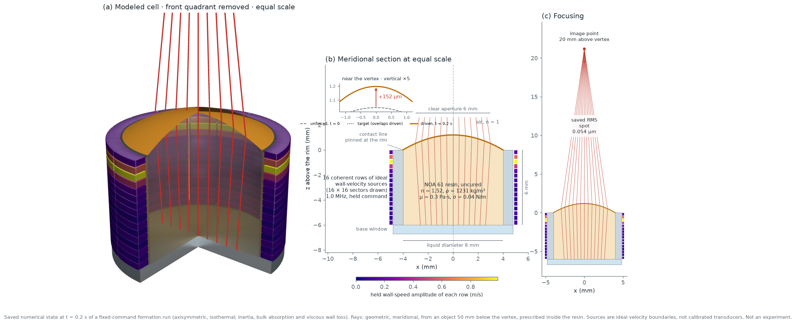
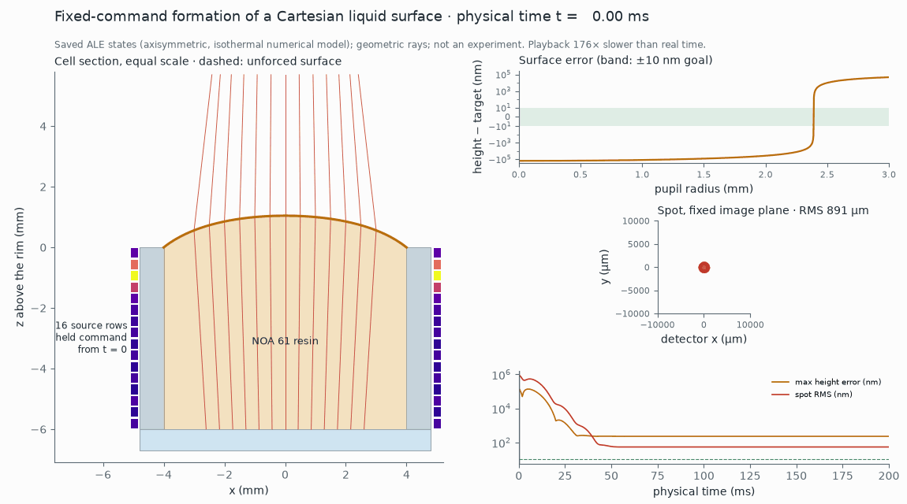
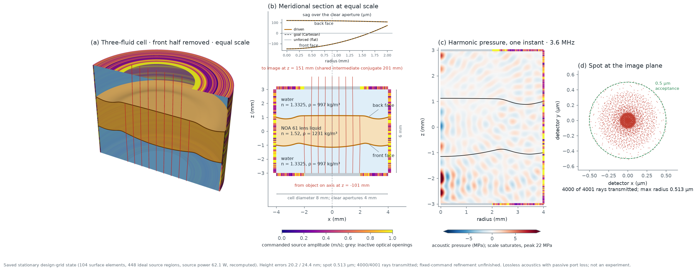

# Acoustic Freeform Lab

Research on shaping fluid interfaces inside a cylinder with admissible
acoustic sources. The primary question is which full-interface mean loads a
bounded continuous source space can produce, and whether the resulting driven
state is reachable and stable. Finite arrays are restricted source spaces.
Cartesian optical surfaces are a later worked target.

## Current evidence

| Gate | Reviewed state |
|---|---|
| General theory | [Canonical LaTeX and bibliography](docs/theory/README.md); compiled PDF kept privately in `artifacts/theory/` |
| Optical target and required load | Positive numerical ideal-load result in a declared three-fluid model; no acoustic source implied |
| Finite emitter synthesis | A coupled design-grid root exists, but the optical gates fail and fixed-command refinement is unfinished |
| Emitter-driven formation | The saved partial Stokes trajectory does not form the target; it does not establish physical impossibility |
| Physical apparatus | No experimental validation or complete thermal, wall-layer mean-streaming and three-dimensional stability assessment |

[Research status](STATUS.md) gives the reviewed verdict and model scope for each
study. [Studies](studies/README.md) link the protocol, reports and saved states.
The active optical height goal is 10 nm maximum cycle-mean error on each fixed
clear aperture; spot and full-ray-coverage gates are separate. A convincing
rendering or a small frozen inverse residual is not a verified physical lens.

## The modeled cells and formation



*Single-interface cell (study S01), from the saved state at 0.2 s. (a) Cutaway
of the declared components: wall, base window, NOA 61 liquid, pinned rim and the
16 coherent rows of ideal wall-velocity sources, coloured by held amplitude.
(b) Section at equal scale; dashed lines are the goal (Cartesian) surface, and
the inset shows the 152 µm acoustic lift of the vertex. (c) Rays traced through the saved surface to the image point 20 mm above
the vertex.*



*Fixed-command formation from the unforced surface, from all 321 saved ALE states
(0–200 ms). The section (dashed: goal surface), rays, pupil height error and fixed-detector spot update
with the displayed physical time. Playback runs about 180× slower than real time
during formation and about 40× slower afterwards. The run ends at 228.5 nm
maximum height error, above the 10 nm goal.
[Formation notes](studies/S01-single-interface/formation-notebook.md).*



*Two-face cell (study S04): NOA 61 between two water layers in a sealed 8 mm
cylinder, held by 448 ideal source regions at 3.6 MHz. (a) Cutaway with both
faces and rays. (b) Section with fluids, source amplitudes and the face sags
against the dashed Cartesian goals. (c) One instant of the recomputed harmonic
pressure. (d) Geometric spot of 4001 rays at the fixed image plane. This is a stationary design-grid state: its height and ray-coverage
gates fail, and fixed-command refinement is unfinished.
[Emitter study](studies/S04-emitter-synthesis/study.md).*

All three are numerical renderings at equal geometric scale unless a panel
says otherwise; none is a photograph or an experiment.
`tools/presentation/render_readme_figures.py` regenerates them from the local saved states
and records input hashes in `figures/provenance.json`.

## Research path

```text
admissible optical target → required full-interface load
                         → acoustic source reachability and synthesis
                         → held-command coupled equilibrium
                         → independent fixed-command refinement
                         → driven stability, formation and later curing
```

The [research contract](docs/research-program.md) and
[architecture](docs/architecture.md) distinguish implemented models, numerical
checks and open physics. The [September numerical-stability note](studies/S01-single-interface/numerical-stability.md)
records the wall-loss finding and limitations. The [documentation index](docs/README.md)
provides detailed historical reports.

## Use the repository

```sh
uv sync --dev
uv run ruff check src tools
python3 tools/documents/build_research_index.py --check
uv run afl --help
```

`afl` exposes every implemented research step: optical target, required load,
finite-source synthesis and diagnostics, held-command equilibrium, wave
refinement, formation and verification. Each step needs a declared JSON
configuration and writes a new directory under `artifacts/`. It is not a
validated end-to-end compiler for arbitrary source distributions. The earlier
models run as `afl single-interface ...` (also `lenslab`) and `afl planar ...`.
[Architecture](docs/architecture.md) lists the commands and package layers.

| Location | Responsibility |
|---|---|
| `docs/theory/` | Canonical general theory; compiled PDFs stay private in `artifacts/theory/` |
| `src/acoustic_freeform/` | Library (apparatus, optics, mechanics, acoustics, inverse, forward, verify, present), research `steps/` and earlier `models/` |
| `studies/` | Reviewed evidence ledger and five scientific questions |
| `configs/` | Immutable inputs grouped by study, shared material records and relocation map; SI units |
| `artifacts/studies/` | Active numerical evidence, grouped by study and excluded from Git |
| `notebooks/` | Editable presentations; executed copies live with their study artifacts |
| `tools/` | Document builds, study audits and presentation checks |
| `references/` | Primary-source reading map and private source library |

Source and artifact milestones, plus superseded exploratory outputs, are
preserved separately in the local research archive. The public
GitHub repository contains the source, LaTeX theory, reviewed study summaries
and README figures. Compiled PDFs, detailed numerical runs and private papers
remain in the local research data tree.
