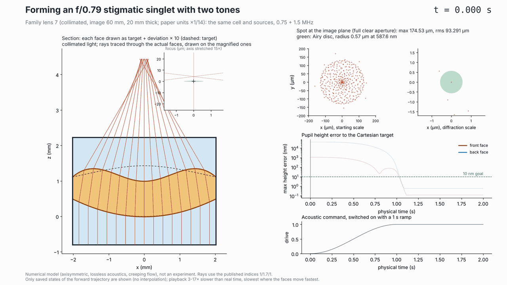

# Acoustic Freeform Lab

Shaping liquid lenses with sound. A UV-curable resin (NOA 61) sits between two
water layers in a small cylinder; ultrasound from the cell's windows and wall
pushes both liquid interfaces into the faces of a stigmatic singlet, which
could then be cured. This repository holds the theory, the numerical model,
the reviewed studies and a design tool that turns a desired lens into the
settings of one fixed machine.

Everything here is a numerical model. Nothing has been built or measured.



*Study S09, family lens 7 (f/0.79), formed in the common water / NOA 61 / water
cell by one tone at 0.75 MHz and one at 1.5 MHz, switched on with a 1 s ramp.
Each face is drawn as the target plus its deviation magnified ×10 (dashed:
target); the deviation starts at 44 µm and ends below 1 nm. Rays are traced
through the actual faces; the spot is shown at its starting scale and at the
diffraction scale with the Airy disc. Every frame is a saved state of the
forward creeping-flow trajectory with its physical time; nothing is
interpolated.*

## What is established

Within the declared model (axisymmetric, lossless acoustics, ideal velocity
sources, quiescent liquids, creeping flow):

| Question | Reviewed state |
|---|---|
| Can one fixed machine hold many lenses? | Yes for the 68 Silva-Lora and Torres singlets that fit the cell: the convex certificate is below 0.5 nm within 1 W for all ([S09](studies/S09-universal-source/study.md)) |
| Do they form from the liquid at rest? | 67 of 68 within 1 nm, 51 with one tone and 16 with two; for lens 57 the start-up ends on another equilibrium |
| Are the formed states converged and stable? | For three designs (Fig. 9b, Fig. 7a with a fold margin, lens 7): mesh and order refinement, coupled stability and formation at two time steps, all within 1 nm; the Fig. 7a design runs at 1.12 W / 2.10 MPa, slightly above the 1 W / 2 MPa caps |
| How many source channels are needed? | First-order only: the certificate stays at 0.025 nm down to 14 channels |
| Physical machine | Not assessed: acoustic streaming, heating, non-axisymmetric disturbances, transducers, curing; a 0.1 % sound-speed change moves the faces by tens to hundreds of nm |

[STATUS.md](STATUS.md) gives the reviewed verdict and evidence states of every
study, [studies/](studies/README.md) the protocols and results. A convincing
rendering or a small frozen residual is not a verified lens.

## Quick start

```sh
uv sync --dev
uv run pytest                       # fast independent checks (seconds)
uv run afl design --object collimated --image 90 --thickness 10 \
    --intermediate 137.95 --scale 1/14 --name "Fig. 9b" --out artifacts/designs/fig9b
```

`afl design` places the lens in the machine of
[`configs/machine/v1.json`](configs/machine/v1.json), checks that it fits,
computes the pin heights and fill volumes, certifies reachability, finds a
one- or two-tone drive command and ramps it up from rest. It writes
`recipe.json` and the per-channel commands, with a status that says what was
and was not established. See [Design a lens](docs/design-a-lens.md).

## How it works

```text
desired lens → load demand of each face (closed form)
             → convex certificate: can this source supply it?   (semidefinite program)
             → one tone per band, within power and pressure limits
             → start-up from the liquid at rest (nonlinear, quasi-static)
             → independent checks: refinement, coupled stability, formation in time
```

The [theory](docs/theory/README.md) derives each step; section 10f covers the
load demand and the convex capability of a fixed source. The
[architecture](docs/architecture.md) lists the packages and commands.

## Repository

| Location | Content |
|---|---|
| `src/acoustic_freeform/design/` | `afl design`: lens description, machine file, recipe |
| `src/acoustic_freeform/` | Library: apparatus, acoustics, mechanics, optics, inverse, forward, verify; research `steps/`; earlier `models/` |
| `configs/machine/` | The fixed machine, declared once |
| `configs/S01…S09/` | Immutable inputs of each study; SI units |
| `studies/` | One folder per scientific question, the evidence ledger and run index |
| `docs/` | Theory (LaTeX), architecture, research contract, user guide |
| `tests/` | Independent checks against closed-form results (`-m slow` runs the solver) |
| `tools/` | Study scripts, document builds and presentation renderers |
| `figures/` | README figures with provenance |

Numerical outputs go to `artifacts/` and stay out of Git, as do compiled PDFs
and private papers. Source and artifact milestones are preserved in a separate
research archive.

## Earlier studies


*Single-interface cell (study S01), from the saved state at 0.2 s: cutaway of
the declared components, section at equal scale with the dashed goal surface,
and rays to the image point 20 mm above the vertex.*


*S01 fixed-command formation from the unforced surface (all 321 saved states,
0–200 ms; playback about 180× slower than real time during formation). The run
ends at 228.5 nm maximum height error, above the 10 nm goal.
[Formation notes](studies/S01-single-interface/formation-notebook.md).*


*Two-face cell (study S04), 448 ideal source regions at 3.6 MHz: a stationary
design-grid state whose height and ray-coverage gates fail.
[Emitter study](studies/S04-emitter-synthesis/study.md).*

These are numerical renderings at equal scale unless a panel says otherwise;
[figures/README.md](figures/README.md) records their sources and checks.

## Citing

See [CITATION.cff](CITATION.cff). Academic claims in the theory and studies
cite their primary references in [docs/theory/references.bib](docs/theory/references.bib).
