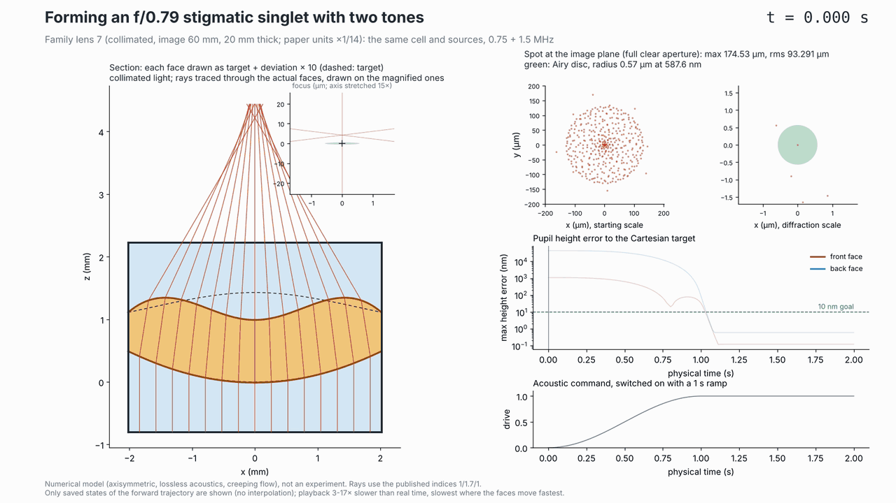
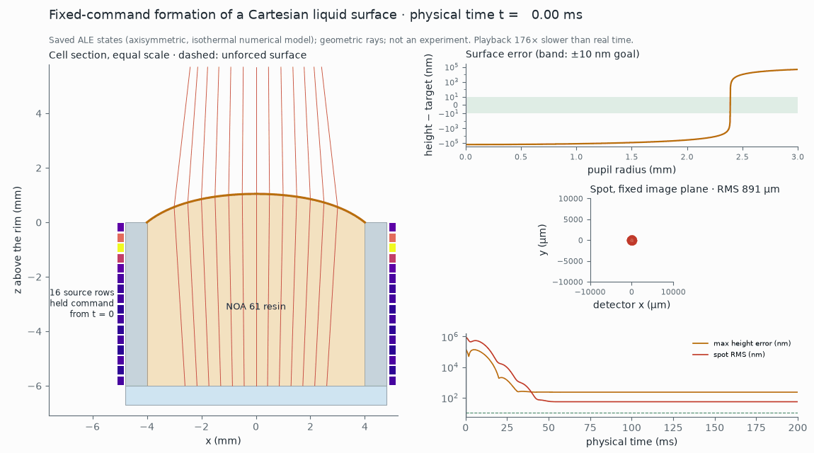
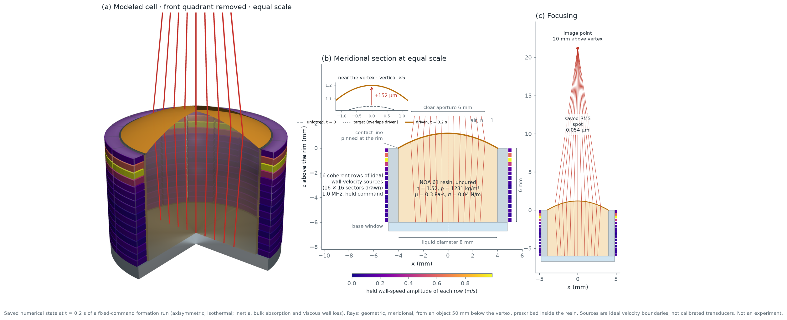
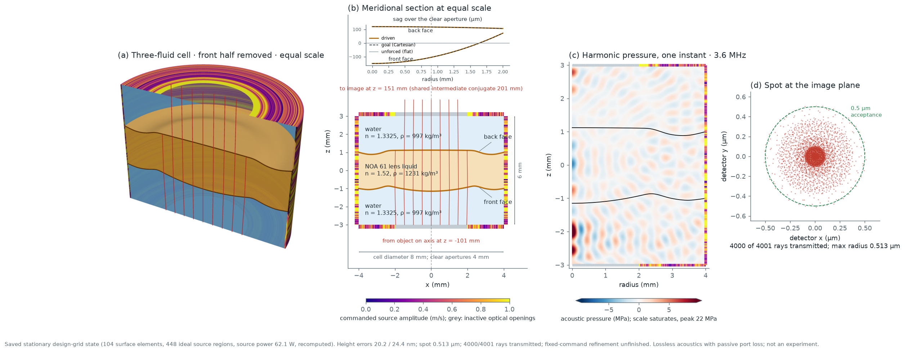

# Acoustic Freeform Lab

Research on shaping liquid lenses with sound. Acoustic sources on a cylindrical
cell's windows and wall deform fluid interfaces toward prescribed optical
surfaces. The project studies the required loads, source reachability,
coupled equilibrium, stability and formation from the unforced meniscus.

## Featured result: two-tone formation of an f/0.79 singlet



*Study S09, family lens 7: a water / NOA 61 / water cell driven at 0.75 and
1.5 MHz with a 1 s ramp. The animation follows all 161 saved states from 0 to
2 s. Each face is drawn as the target plus its deviation magnified ×10
(dashed: target); rays use the actual computed faces. The largest initial
surface error is 43.8 µm; the final errors are 0.12 nm on the front face and
0.61 nm on the back face. The spot is shown at its initial scale and alongside
the Airy disc. This is a saved forward numerical trajectory, not an experiment.*

| Quantity | S09 lens 7 |
|---|---|
| Cell | Water / NOA 61 / water; 2.02 mm bore radius, 4 mm clear aperture |
| Source space | 112 ideal source regions, driven through 26 spatial modes per band |
| Acoustic drive | 0.75 + 1.5 MHz; reported total source power 0.55 W |
| Sampled peak pressure | 0.98 and 1.25 MPa in the two bands |
| Final maximum pupil height error, front / back | 0.12 / 0.61 nm at both 25 and 12.5 ms time steps |
| Optical prescription | Silva-Lora and Torres family, scaled 1/14; refractive indices 1 / 1.7 / 1 |
| Geometric spot RMS / maximum radius | 0.010 / 0.125 µm with those prescribed indices |
| Airy radius | 0.57 µm at 587.6 nm |
| Fixed-command refinement | Maximum change 0.39 nm; polynomial-order P3 check 1.4 nm |
| Coupled creeping-flow stability | Slowest reported decay rate −84.8 s⁻¹ on the 128 × 24 mesh |

The improved example is recorded on
[`claude/code-review-interface-auii06`](https://github.com/blancusjh/Acoustic-Lens-Shaping-in-Fluids/tree/claude/code-review-interface-auii06),
at revision [`73369f5`](https://github.com/blancusjh/Acoustic-Lens-Shaping-in-Fluids/commit/73369f5aa36f303246003680b0daafc1524566b3).
The figure and evidence links here are pinned to that revision because the
S09 implementation and studies are not yet on `main`:
[study and numerical checks](https://github.com/blancusjh/Acoustic-Lens-Shaping-in-Fluids/blob/73369f5aa36f303246003680b0daafc1524566b3/studies/S09-universal-source/study.md),
[figure provenance](https://github.com/blancusjh/Acoustic-Lens-Shaping-in-Fluids/blob/73369f5aa36f303246003680b0daafc1524566b3/figures/s09-formation-provenance.json),
[drive configuration](https://github.com/blancusjh/Acoustic-Lens-Shaping-in-Fluids/blob/73369f5aa36f303246003680b0daafc1524566b3/configs/S09-universal-source/atlas7-water-common-2band-1w-2mpa.json),
and [formation configuration](https://github.com/blancusjh/Acoustic-Lens-Shaping-in-Fluids/blob/73369f5aa36f303246003680b0daafc1524566b3/configs/S09-universal-source/formation-atlas7-2band-dt00125.json).

## Current numerical evidence

S09 extends the earlier single-interface and two-face examples to a common
machine and a family of stigmatic singlets.

| Question | Reported result in S09 |
|---|---|
| Source capability | The convex bound is below 0.5 nm for all 68 family singlets that fit the cell, within the stated 1 W cap |
| Nonlinear start-up | 67 of 68 reach a start-up branch endpoint within 1 nm: 51 with one tone and 16 with two; lens 57 reaches another equilibrium |
| Full formation checks | Fig. 9b, Fig. 7a with a fold margin, and lens 7 have time-dependent formation at two time steps, fixed-command refinement and coupled-stability checks |
| Operating limits | The Fig. 7a fold-margin design uses 1.12 W / 2.10 MPa, above the nominal 1 W / 2 MPa caps |
| Physical validation | No apparatus has been built or measured |

These results apply to the declared axisymmetric, lossless-acoustic,
ideal-source, creeping-flow model. The saved formation run uses a linearized
acoustic load with periodic tangent refresh. The optical trace uses the
published singlet's prescribed indices listed above. Sub-nanometre residuals do not establish
sub-nanometre physical accuracy: the refinement changes are comparable to or
larger than those residuals. Streaming, heating, non-axisymmetric disturbances,
transducer realization and curing remain unassessed; small sound-speed
changes can move the interfaces by tens to hundreds of nanometres.

The [S09 study](https://github.com/blancusjh/Acoustic-Lens-Shaping-in-Fluids/blob/73369f5aa36f303246003680b0daafc1524566b3/studies/S09-universal-source/study.md)
distinguishes the family-wide start-up checks from the three designs with
full time-dependent formation checks. Its
[research status](https://github.com/blancusjh/Acoustic-Lens-Shaping-in-Fluids/blob/73369f5aa36f303246003680b0daafc1524566b3/STATUS.md) covers S01–S09.
The [status on main](STATUS.md) and [study index on main](studies/README.md)
currently cover the earlier S01–S05 work.

## Single-interface array and formation



*Study S01 shows the 16 coherent rows of the acoustic array and the
fixed-command evolution of one fluid interface from its unforced state. The
animation contains all 321 saved ALE states from 0 to 200 ms; the dashed curve
is the Cartesian target, while the rays, pupil-height error and fixed-detector
spot follow the computed surface. The run ends at 228.5 nm maximum height
error, above the 10 nm goal, so it is retained as a particularly clear view of
the array and formation dynamics rather than as the best achieved lens.
[Formation notes](studies/S01-single-interface/formation-notebook.md).*

## Research path

```text
admissible optical target → required full-interface load
                         → acoustic source reachability and synthesis
                         → held-command coupled equilibrium
                         → independent fixed-command refinement
                         → driven stability, formation and later curing
```

The [research contract](docs/research-program.md) and
[architecture](docs/architecture.md) distinguish implemented models, numerical
checks and open physics. The [September numerical-stability note](studies/S01-single-interface/numerical-stability.md)
records the wall-loss finding and limitations. The [documentation index](docs/README.md)
provides detailed historical reports.

## Use the repository

The commands and paths below describe the code currently on `main`. For the
S09 implementation and its design workflow, use the
[recorded S09 revision](https://github.com/blancusjh/Acoustic-Lens-Shaping-in-Fluids/blob/73369f5aa36f303246003680b0daafc1524566b3/README.md) and its
[design guide](https://github.com/blancusjh/Acoustic-Lens-Shaping-in-Fluids/blob/73369f5aa36f303246003680b0daafc1524566b3/docs/design-a-lens.md).

```sh
uv sync --dev
uv run ruff check src tools
python3 tools/build_research_index.py --check
uv run afl --help
```

`afl` exposes the implemented target, load, finite-source synthesis, held-command
equilibrium, wave-refinement and formation steps. Each command needs a declared
JSON configuration and writes a new directory under `artifacts/`. It is not a
validated end-to-end compiler for arbitrary source distributions. The older
single-interface CLI remains `lenslab`.

| Location | Responsibility |
|---|---|
| `docs/theory/` | Canonical general theory; compiled PDFs stay private in `artifacts/theory/` |
| `src/acoustic_freeform/` | Physics and algorithms grouped by apparatus, optics, mechanics, acoustics, inverse, forward and verification |
| `studies/` | Reviewed evidence ledger and five scientific questions |
| `artifacts/studies/` | Active numerical evidence, grouped by study and excluded from Git |
| `configs/` | Immutable historical inputs and relocation map; all solver values use SI units |
| `notebooks/` | Editable presentations; executed copies live with their study artifacts |
| `references/` | Primary-source reading map and private source library |

Source and artifact milestones, plus superseded exploratory outputs, are
preserved separately in the local research archive. The public
GitHub repository contains the source, LaTeX theory, reviewed study summaries
and README figures. Compiled PDFs, detailed numerical runs and private papers
remain in the local research data tree.

## Earlier examples: S01 and S04

These earlier studies document intermediate results; S09 above is the featured
lens example.

<details>
<summary>Show the earlier static cell renderings</summary>



*Single-interface cell (study S01), from the saved state at 0.2 s. (a) Cutaway
of the declared components: wall, base window, NOA 61 liquid, pinned rim and the
16 coherent rows of ideal wall-velocity sources, coloured by held amplitude.
(b) Section at equal scale; dashed lines are the goal (Cartesian) surface, and
the inset shows the 152 µm acoustic lift of the vertex. (c) Rays traced through the saved surface to the image point 20 mm above
the vertex.*



*Two-face cell (study S04): NOA 61 between two water layers in a sealed 8 mm
cylinder, held by 448 ideal source regions at 3.6 MHz. (a) Cutaway with both
faces and rays. (b) Section with fluids, source amplitudes and the face sags
against the dashed Cartesian goals. (c) One instant of the recomputed harmonic
pressure. (d) Geometric spot of 4001 rays at the fixed image plane. This is a stationary design-grid state: its height and ray-coverage
gates fail, and fixed-command refinement is unfinished.
[Emitter study](studies/S04-emitter-synthesis/study.md).*

These historical figures are numerical renderings at equal geometric scale unless a panel
says otherwise; none is a photograph or an experiment.
`tools/render_readme_figures.py` regenerates them from the local saved states
and records input hashes in `figures/provenance.json`.

</details>

## License

Original project code and documentation are licensed under the [Apache License 2.0](LICENSE).
Third-party code, publications, datasets, fonts, and other assets retain their
respective licenses and copyright notices; this license does not replace them.
